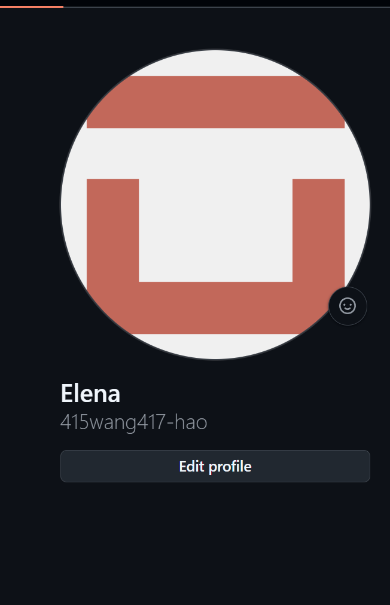
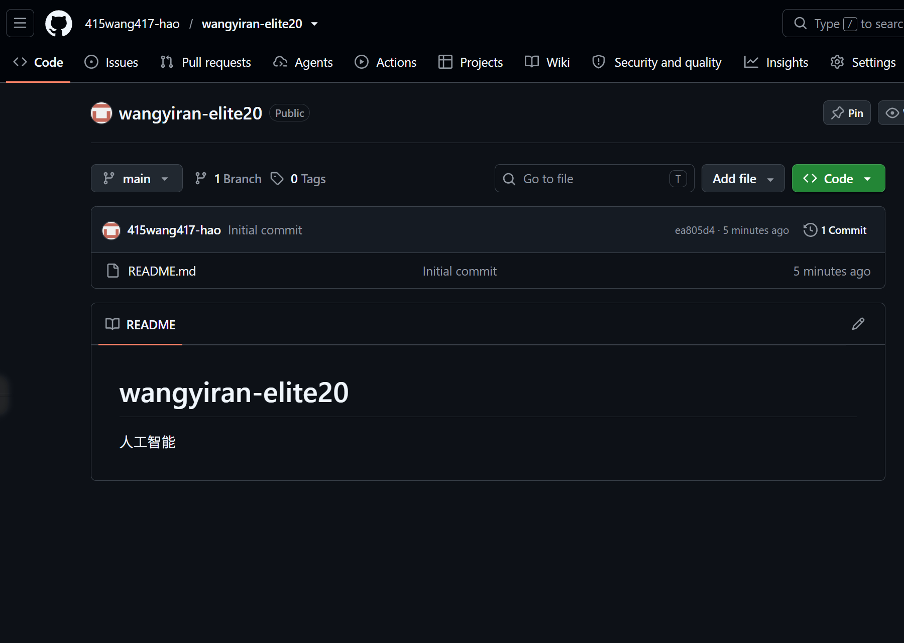
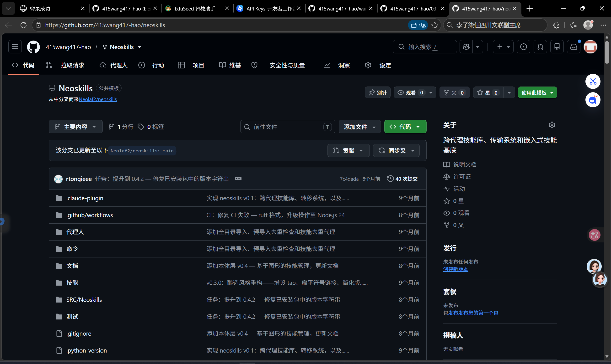
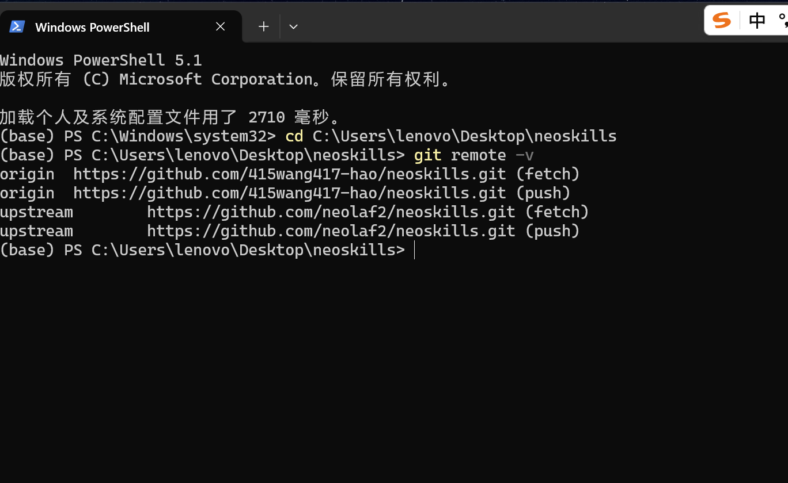
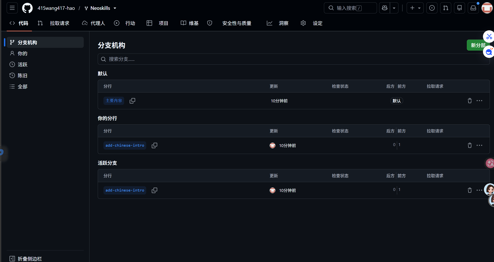
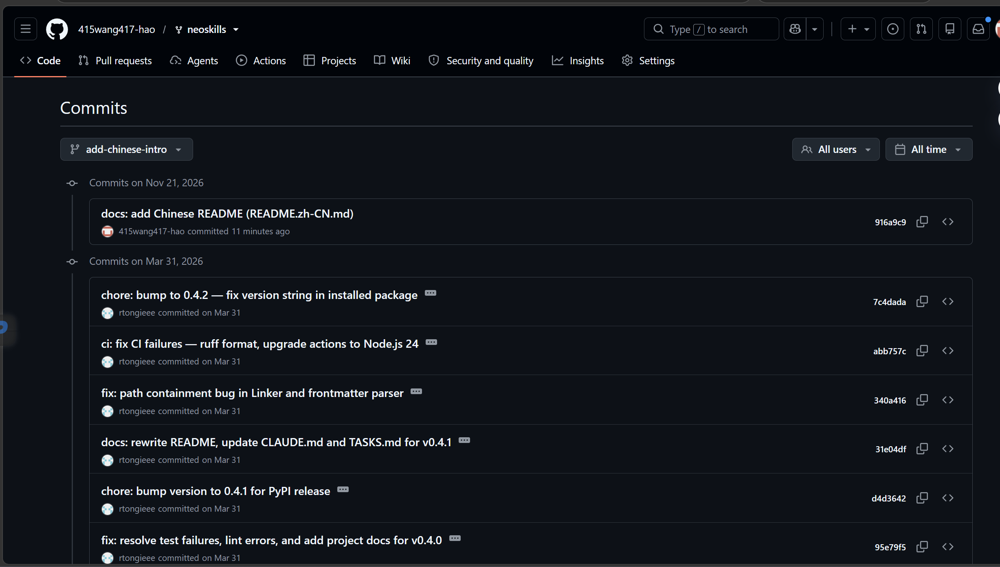

# wangyiran-elite20

> 王艺燃的 Elite 20 挑战作品集仓库 —— 记录从「会用 AI」到「能和 AI 一起做工程」的过程。

## 关于我

- **姓名：** 王艺燃
- **专业：** 人工智能
- **方向：** AI 工具链、提示工程、智能体协作
- **一句话介绍：** 正在通过 Elite 20 挑战系统学习 AI 工具与工程协作，相信「动手做」是最好的学习方式。
- **当前状态：** 完成 C5A（GitHub 入门与仓库理解），进入 C5B（代码贡献）

## 这个仓库是什么

不是资料收藏夹，而是**可核验的动手记录**。每个挑战都留下三样东西：

1. **产物** —— 实际做出来的东西（仓库、分支、PR、分析文档）
2. **过程** —— AAR 复盘与 AI 使用日志
3. **证据** —— 可点开验证的链接与截图

评审可以直接从下面的表格点到 GitHub 上核对，不需要相信我的一面之词。

## 挑战进度

| 挑战 | 主题 | 状态 | 核心产物 |
|------|------|------|----------|
| C5A | GitHub 入门与仓库理解 | ✅ 已完成 | 仓库分析文档 + fork 实践 + 分支贡献 + 上游 PR + 截图证据 |
| C5B | 代码贡献 | 🔜 进行中 | — |

## C5A 成果索引

### 1. 仓库分析（Level 4）

- 📄 [`王艺燃_C5A_仓库分析.md`](./王艺燃_C5A_仓库分析.md)
  对开源仓库 [neolaf2/neoskills](https://github.com/neolaf2/neoskills) 的深度分析：项目定位、目录结构、技术栈、代码组织、可贡献点评估。

### 2. Fork 与本地克隆

- 🍴 Fork 仓库：[415wang417-hao/neoskills](https://github.com/415wang417-hao/neoskills)
  保留 `upstream` 指向源仓库，具备跟踪上游更新的能力。
- 💻 本地开发环境：`origin`（自己的 fork）+ `upstream`（源仓库）双远端配置。

### 3. 分支贡献（Level 3）

- 🌿 分支：[`add-chinese-intro`](https://github.com/415wang417-hao/neoskills/tree/add-chinese-intro)
- 📝 新增文件：`README.zh-CN.md` —— 原文 README 的完整中文翻译版，保留全部代码块、命令与链接结构，不覆盖原文。

### 4. 上游 Pull Request

- 🔀 PR：[neolaf2/neoskills#6](https://github.com/neolaf2/neoskills/pull/6)
  `docs: add Chinese README (README.zh-CN.md)` —— 从 `add-chinese-intro` 合入 `main`。

### 5. AI 使用日志

- 🤖 [`王艺燃_C5A_AI日志.md`](./王艺燃_C5A_AI日志.md)
  逐轮记录 AI 做了什么、我下的指令、我的调整与评价，以及「AI 擅长什么 / 替代不了什么」的边界判断。

### 6. AAR 复盘

- 🔁 [`王艺燃_C5A_AAR.md`](./王艺燃_C5A_AAR.md)
  按 What / Learn / Verify / 坑与反思 / Next 五段复盘：包括把 Fork 误当成 Clone 的认知纠正、读陌生仓库的四步法、下一步行动。

### 7. 提交前核验报告

- ✅ [`王艺燃_C5A_提交前核验报告.md`](./王艺燃_C5A_提交前核验报告.md)
  提交前逐项用 GitHub REST API 实测核验（仓库、fork 关系、分支、PR 状态），附 sha 与实测结论。

## 证据对照表

| 环节 | 核验入口 |
|------|----------|
| ① 个人仓库 | 本仓库（`main` 分支） |
| ② Fork | [415wang417-hao/neoskills](https://github.com/415wang417-hao/neoskills) 页面顶部 `forked from neolaf2/neoskills` |
| ③ Clone | 本地 `git remote -v` 显示双远端（截图 04） |
| ④ 分支 + 中文 README | [分支内容](https://github.com/415wang417-hao/neoskills/blob/add-chinese-intro/README.zh-CN.md)（截图 05 / 06） |
| ⑤ PR | [PR #6](https://github.com/neolaf2/neoskills/pull/6) |
| ⑥ 分析文档 | 本仓库 [`王艺燃_C5A_仓库分析.md`](./王艺燃_C5A_仓库分析.md) |
| ⑦ AI 使用过程 | [`王艺燃_C5A_AI日志.md`](./王艺燃_C5A_AI日志.md) |
| ⑧ 复盘与改进 | [`王艺燃_C5A_AAR.md`](./王艺燃_C5A_AAR.md) |

## 截图证据

全部截图均为本人操作时的真实界面记录，未做拼接或修改。

**① GitHub 账号主页（用户名 415wang417-hao）**



**② 个人仓库 wangyiran-elite20 创建成功**



**③ Fork neolaf2/neoskills 到本人账号**



**④ Clone 到本地（origin / upstream 双远端）**



**⑤ 创建分支 add-chinese-intro**



**⑥ 提交中文 README（commit 记录）**



> 截图与对应核验要点的文字清单见 [`screenshots/截图清单.md`](./screenshots/截图清单.md)。

## 我用的工具与技术

- **版本控制：** Git / GitHub（fork、branch、commit、PR 工作流）
- **命令行：** PowerShell、GitHub CLI（`gh`）
- **AI 协作：** 用 AI 辅助仓库结构分析、文档翻译与工作流核对，并对 AI 输出做人工验证
- **核验方法：** 用 GitHub REST API 读取真实仓库状态（commit sha、fork 关系、PR 状态），不依赖本地自测
- **文档：** Markdown

## 目录结构

```
wangyiran-elite20/
├── README.md                        # 本文件（成果索引 + 证据对照）
├── 王艺燃_C5A_仓库分析.md            # neoskills 仓库深度分析（Level 2 + Level 4）
├── 王艺燃_C5A_AI日志.md              # AI 使用全过程记录
├── 王艺燃_C5A_AAR.md                # 复盘：所学、验证方式、坑与改进
├── 王艺燃_C5A_提交前核验报告.md      # 提交前 API 实测核验证据
└── screenshots/                     # ①–⑥ 真实操作截图
    ├── 01_GitHub账号主页.png
    ├── 02_个人仓库创建.png
    ├── 03_Fork仓库.png
    ├── 04_Clone本地.png
    ├── 05_建分支.png
    ├── 06_提交中文README.png
    └── 截图清单.md
```

## 更新日志

| 日期 | 变更 |
|------|------|
| 2026-11-21 | 补全证据包：AI 日志、AAR 复盘、提交前核验报告、①–⑥ 截图，README 增加截图与证据索引 |
| 2026-11-21 | C5A 完成：仓库分析文档、fork、中文 README 分支、上游 PR #6 |
| 2026-11-21 | 创建仓库并写入初始 README（姓名 / 专业 / 一句话介绍） |

## 联系

- GitHub：[@415wang417-hao](https://github.com/415wang417-hao)

---

<sub>本仓库为 Elite 20 挑战学习记录，持续更新。</sub>
